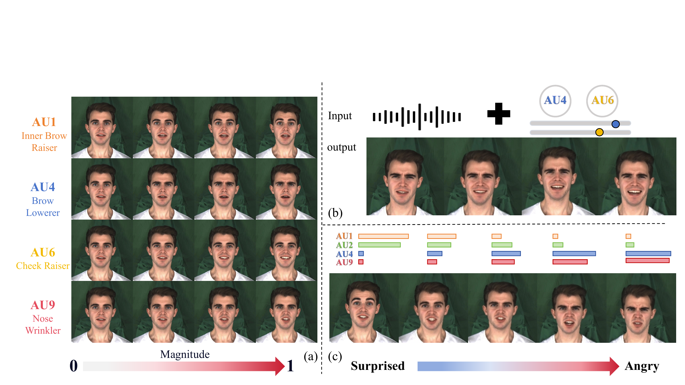
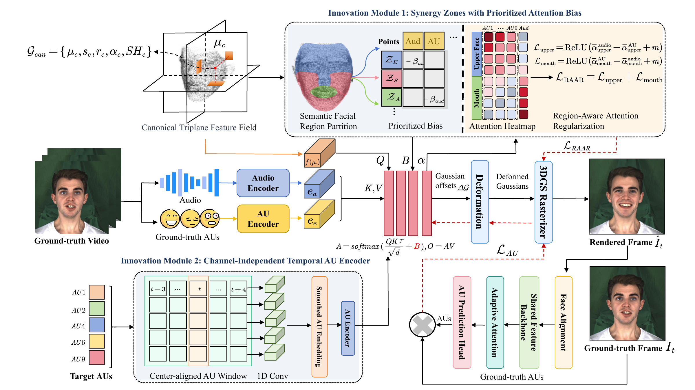

# EmoZone-Talker: Regional Semantic Control of Audio-Driven 3DGS Talking Heads via Facial Action Units

<div align="center">
  

  <br>

  [Paper](https://doi.org/10.1145/3767308.3835650) / [Pretrained Models](#pretrained-weights) / [Inference](#inference)
</div>

This repository contains the inference code for
**EmoZone-Talker**, accepted at ACM Multimedia 2026. EmoZone-Talker combines
audio with editable facial Action Unit (AU) trajectories to provide local,
continuous expression control for audio-driven 3D Gaussian talking heads.



.

The inference model uses Synergy Zones with Prioritized Attention Bias
(SZ-PAB) to allocate audio and AU responsibility by facial region, and a
Channel-Independent Temporal AU Encoder (CIT-AE) to stabilize frame-level AU
controls. The editable controls are AU1, AU2, AU4, AU6, and AU9. AU45 is used
for blinking.

## License

This code is released for non-commercial research and evaluation under
[LICENSE.md](LICENSE.md). It builds on
[GaussianTalker](https://github.com/joungbinlee/GaussianTalker) and the
[3D Gaussian Splatting](https://github.com/graphdeco-inria/gaussian-splatting)
codebase. The bundled rasterizer retains its original license in
`submodules/custom-bg-depth-diff-gaussian-rasterization/LICENSE.md`.

## Setup

### 1. Installation

A CUDA-capable NVIDIA GPU and a working CUDA 11.7 toolchain are required. The
reference environment uses Python 3.8 and PyTorch 1.13.1.

```shell
conda create -n emozone python=3.8 -y
conda activate emozone

pip install -r requirements.txt
pip install -e submodules/custom-bg-depth-diff-gaussian-rasterization
pip install -e submodules/simple-knn
```

Install [FFmpeg](https://ffmpeg.org/) and ensure `ffmpeg` is available on
`PATH`. The CUDA extensions must be compiled on the target machine; compiled
binaries are not included.

### 2. Pretrained weights

Pretrained models are distributed separately from the source repository. Put
the downloaded iteration-10,000 snapshots under `weights/`. See
[weights/README.md](weights/README.md) for the subject list and expected
directory format.

### 3. Processed subject data

Rendering also needs the processed subject data used to estimate camera,
geometry, torso, and background information. At minimum, each subject
directory should contain:

```text
data/<subject>/
  gt_imgs/
  ori_imgs/
    0.jpg
    0.lms
  torso_imgs/
  au.csv
  aud_ds.npy
  aud_train.wav
  aud_novel.wav
  bc.jpg
  fused.ply
  track_params.pt
  transforms_train.json
  transforms_val.json
```

Follow the data preparation protocol from
[GaussianTalker](https://github.com/joungbinlee/GaussianTalker#data-preparation)
to produce these files. Input video is expected at 25 FPS and audio at 16 kHz.

## Inference

### Self-reconstruction or test split

```shell
python render.py \
  -s data/obama \
  -m weights/obama \
  --configs arguments/64_dim_1_transformer.py \
  --iteration 10000 \
  --batch 8 \
  --skip_train
```

Rendered videos and attention visualizations are written below
`weights/obama/test/ours_10000/`.

### Custom audio and AU control

Place the custom WAV, the frame-aligned DeepSpeech feature array, and the AU
CSV inside the processed subject directory. The audio feature array must have
shape `[N, 16, 29]`. The CSV may use values in `[0, 5]` (OpenFace convention)
or normalized values in `[0, 1]` and must contain:

```text
AU01_r, AU02_r, AU04_r, AU06_r, AU09_r, AU45_r
```

An editable template is provided at
[examples/custom_au.csv](examples/custom_au.csv).

```shell
python render.py \
  -s data/obama \
  -m weights/obama \
  --configs arguments/64_dim_1_transformer.py \
  --iteration 10000 \
  --batch 8 \
  --custom_aud custom_aud.npy \
  --custom_wav custom_aud.wav \
  --custom_au custom_au.csv \
  --skip_train \
  --skip_test
```

The output length follows the custom audio feature array. The validation-set
camera trajectory is cycled as needed, and the AU trajectory is padded or
truncated to the same length. For precise control, generate one CSV row per
rendered frame.

<details>
<summary><strong>Key command-line arguments</strong></summary>

- `-s`, `--source_path`: processed subject directory.
- `-m`, `--model_path`: subject-specific pretrained model directory.
- `--iteration`: model iteration to load; bundled models use `10000`.
- `--batch`: frames per rendering batch; reduce it if GPU memory is limited.
- `--custom_aud`: DeepSpeech `.npy` filename relative to `source_path`.
- `--custom_wav`: WAV filename relative to `source_path`.
- `--custom_au`: AU CSV filename relative to `source_path`.
- `--skip_train`, `--skip_test`: disable standard split rendering.

</details>

## Repository layout

```text
Emozone/
  arguments/             model configuration
  gaussian_renderer/     differentiable 3DGS rendering
  scene/                 EmoZone deformation and data loading
  submodules/            CUDA rasterizer and nearest-neighbor kernels
  utils/                 inference utilities
  examples/              AU-control input template
  media/                 paper figures used by this README
  weights/               pretrained-model placement guide
  render.py              inference entry point
  requirements.txt       Python dependencies
```

## Acknowledgements

We thank the authors of GaussianTalker, 3D Gaussian Splatting, and the public
datasets and tools used in this work, including MEAD and OpenFace.

## Citation

If you find this work useful, please cite:

```bibtex
@inproceedings{chen2026emozone,
  title     = {EmoZone-Talker: Regional Semantic Control of Audio-Driven 3DGS Talking Heads via Facial Action Units},
  author    = {Chen, Tingting and Wang, Shaojun and Zhang, Huaye and Jiang, Diqiong and Chen, Chenglizhao},
  booktitle = {Proceedings of the 34th ACM International Conference on Multimedia},
  year      = {2026},
  doi       = {10.1145/3767308.3835650}
}
```
